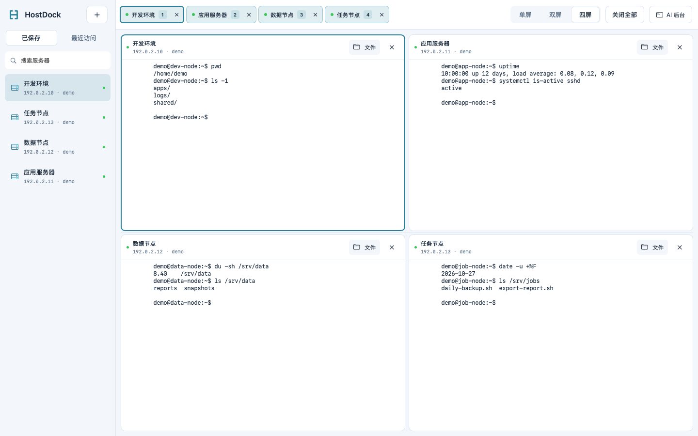

# HostDock

## 项目简介

HostDock 是一款原生 macOS SSH/SFTP 客户端，集成交互终端、服务器文件管理与本机文件传输，支持普通 SSH 和 JumpServer 接入。



图中服务器、账号和终端内容均为演示数据。

## 主要功能

- 多服务器标签与单屏、双屏、四屏布局，切换时保留终端、目录和传输。
- 终端与远端文件列表并排显示，按需切换双栏文件传输。
- 文件及文件夹递归上传、下载，支持进度、取消、同名确认和可恢复覆盖。
- 文件右键操作、属性查看、权限修改及 UTF-8 远程文本编辑。
- 保存连接、本机加密记住认证、主机指纹确认及共享 JumpServer 配置。
- 深浅外观、中文菜单和默认关闭的本机 CLI 自动化接口。

## 系统要求

- Apple Silicon Mac（arm64）。
- 最低构建目标 macOS 14.0；macOS 14 实机及其他 Mac 尚未验收。
- SSH/SFTP 服务，或允许 SSH/SFTP 接入的 JumpServer 网关。

## 下载与安装

前往 [最新版下载](https://github.com/wsfwsfwsf2017-gif/HostDock/releases/latest)，选择 DMG 或 ZIP。[历史版本](https://github.com/wsfwsfwsf2017-gif/HostDock/releases) · [更新记录](CHANGELOG.md)。

1. 下载 DMG，将 HostDock 拖入 Applications；或解压 ZIP 后将 App 放入「应用程序」。
2. 可同时下载两个安装包和 `SHA256SUMS.txt`，在所在目录执行 `shasum -a 256 -c SHA256SUMS.txt` 核对完整性。
3. 从「应用程序」打开 HostDock。

目前采用本地临时签名，未经 Developer ID 签名及 Apple 公证。确认下载来源及 SHA-256 后，如 macOS 阻止打开，可到「系统设置 → 隐私与安全性」选择「仍要打开」。不需要关闭系统安全保护。

## 常用操作

- 左侧「已保存／最近访问」每次单击新建独立连接，同一服务器可打开多个标签。加号或 `⌘K` 新建连接；普通 SSH 填写地址、账号与密码，JumpServer 先配置堡垒机和已有 RSA 私钥，再填写目标资产。
- 验证 SSH 和 SFTP 成功、认证保存完整后，连接进入「已保存」，下次可直接连接。
- 「终端」模式显示终端及远端文件；「文件传输」模式显示本机和远端两栏。上传使用工具栏或右键菜单；下载在远端文件列表右键操作，终端模式先选择本机保存目录，文件传输模式保存到左侧当前目录。
- 右键文件进行常用操作；远程编辑使用 `⌘S` 上传，遇到远端变化时由用户决定处理方式。
- 右上角选择单屏、双屏或四屏；先点击空位，再点击服务器或标签填入。正在展示的标签高亮并标注区域编号，活动标签另有强调边框。分屏内「文件」可临时放大，随后返回分屏；格内关闭仅移出分屏、保留连接，关闭顶部标签才会断开对应会话。最后一个标签关闭后恢复初始单屏页。
- 已断开标签点击「重新连接」即可直接重连；认证缺失或失效时，主动选择「修改认证…」。顶部「关闭全部」关闭所有人工标签，有传输或未上传编辑时合并确认并保留草稿，AI 后台连接不受影响。
- CLI 使用前，手动打开「设置 → AI 与自动化 → 允许 AI 操作 HostDock」。AI 使用独立后台连接，可在右上角「AI 后台」查看和停止。完整命令见 [命令行说明](docs/AUTOMATION.md)。

认证使用应用管理的本机加密文件保存，不使用钥匙串。密钥与密文都位于本机，同账户程序可能读取；私钥仍须保留在用户选择的位置。部分 JumpServer 不支持标准 exec，CLI 会明确报错，可使用交互终端。

## 本地构建

构建需要 Swift 6.2+、macOS SDK、Python 3.9+ 和 Git。CI 使用 macOS 15 ARM runner 与 Xcode 26.2；可在支持相应工具链的 Mac 上执行：

```sh
git clone https://github.com/wsfwsfwsf2017-gif/HostDock.git
cd HostDock
./scripts/test.sh
./scripts/build-app.sh
swift scripts/install-app.swift
```

构建仅保留 `dist/HostDock-build.zip`；安装器临时解包并更新 `/Applications/HostDock.app`，用完即清理副本，旧版和上次构建压缩归档。CLI 位于安装应用内 `Contents/Helpers/hostdock`。版本以 `packaging/Info.plist` 为准，依赖以 `Package.resolved` 锁定。正式打包和后续更新见 [发布维护说明](docs/RELEASING.md)。

## 许可证

HostDock 采用 [MIT 许可证](LICENSE)。第三方组件保留各自版权和许可证，见 [第三方声明](THIRD_PARTY_NOTICES.md)；许可原文、NOTICE 和本地补丁随 App 放在 `Contents/Resources/Licenses`。

This product includes software developed by Niels Provos.
